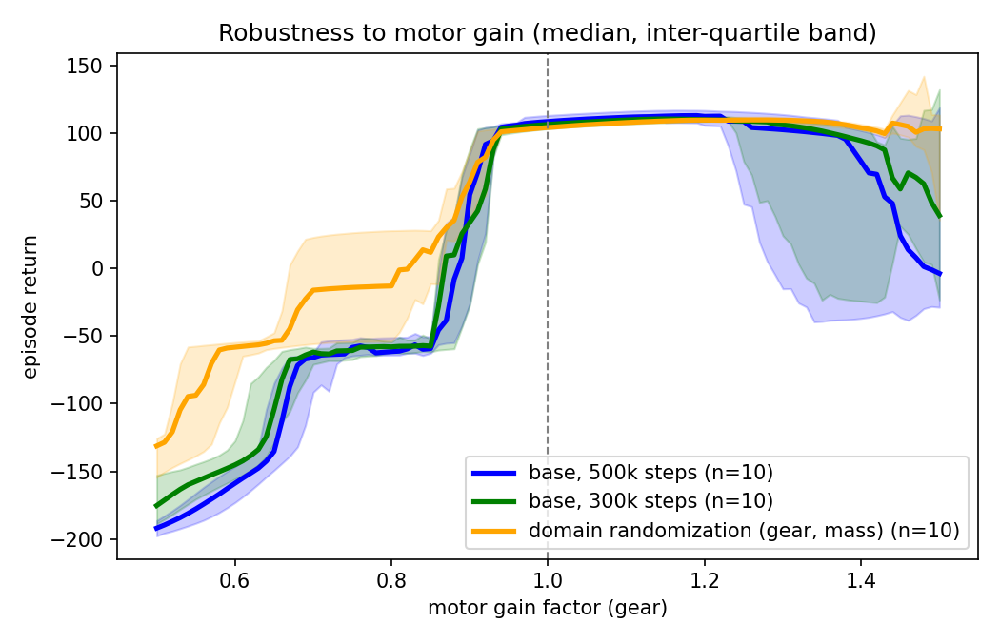
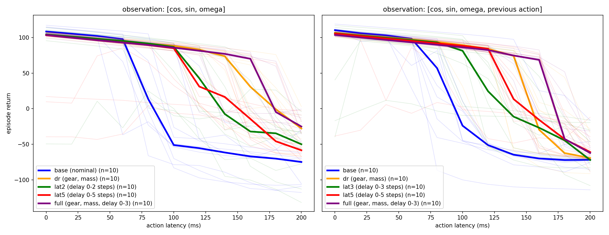

# Sim-to-real gap on a MuJoCo pendulum

A small personal project to get hands-on with **MuJoCo**, **Gymnasium** and **PPO** (stable-baselines3).
It studies a toy version of the sim-to-real problem: a policy trained in a perfect simulator is run in a
slightly different one (weaker/stronger motor, different mass, delayed commands). I measure how much
performance is lost and whether **domain randomization (DR)** helps.

> Scope: everything runs in simulation. The "real" system is emulated by perturbing the simulator's
> parameters, and the plant is a single pendulum. This is an exploration project, not a validated result on hardware.

## Task and environment

`sim2real/env.py` is a Gymnasium environment built on a hand-written MJCF model (`sim2real/model.py`):
a pendulum (0.6 m rod, 1 kg bob) driven by one motor at the pivot.

- **Goal:** swing the pendulum up from the hanging position and keep it upright. The motor (max 3 N·m) is weaker than the
  gravity torque at horizontal (about 6 N·m), so the policy has to pump energy over several swings.
- **Observation:** `[cos θ, sin θ, ω]` (optionally + previous action). **Action:** motor command in `[-1, 1]`.
- **Reward:** `-cos θ - 0.01 ω² - 0.001 a² - 0.001 (a - a_prev)²`. An episode is 250 control steps of 20 ms (5 s), max return 250.
- **Perturbable simulator:** `set_params(mass, damping, gear, delay)` changes the physics from the nominal values;
  `randomize={param: (lo, hi)}` redraws them at every `reset()` (domain randomization). `delay` is an action latency in control steps (1 step = 20 ms).

A successful policy gets a return of about +100 to +110; a policy that never stabilizes the pendulum stays near or below 0.

## Policies compared

All policies are PPO (`MlpPolicy`, 500k steps unless stated, 8 parallel envs), **10 training seeds per family**.

| family | what is randomized during training |
|---|---|
| `base` | nothing (nominal physics); also trained for 300k steps (`base300k`) |
| `dr` | motor gain ×U(0.7, 1.3), mass ×U(0.8, 1.2) |
| `lat2`, `lat5` | action delay drawn in {0..2} / {0..5} steps (0-40 / 0-100 ms) only |
| `full` | gain, mass **and** delay in {0..3} steps (0-60 ms) |

Each family was also trained with the previous action added to the observation (`+ prev action`) to check whether
knowing the last command helps with latency. That is 110 policies in total.

**Evaluation.** One parameter is perturbed at a time, all models are tested on the same 10 start states
(start angle in ±0.1 rad) with a deterministic policy, and curves show the **median over the 10 seeds** (thin lines = individual seeds).
A run is called a success when its return is above 50, which separates the two clusters visible in the data (about +100 vs. about 0 or below).

## Results

### 1. Motor gain



- Every family fails below roughly 0.9× nominal gain. I did not test why (my guess is that the motor is then too weak to swing up within 5 s).
- Between 0.9× and 1.5×, baseline models hold about +105 up to ~1.3×, then some seeds collapse (wide bands). DR stays high up to the end of the sweep.
- Width of the success window around 1.0× (contiguous gain range with return > 50), mean ± std over 10 seeds:
  `base` 0.47 ± 0.12, `base300k` 0.43 ± 0.19, `dr` 0.59 ± 0.02. The sweep stops at 1.5×, and most `dr` windows reach that bound, so 0.59 is a lower bound.
- 300k vs. 500k training steps: no clear difference (means within one standard deviation).

### 2. Action latency



First latency at which the median return drops below 50 ("threshold"), nominal return, and number of seeds that failed even without latency:

| observation | family | nominal return | threshold | seeds failed at 0 ms | seeds failed at 100 ms |
|---|---|---|---|---|---|
| standard | `base` | 108 | 80 ms | 0/10 | 8/10 |
| standard | `dr` | 104 | 160 ms | 0/10 | 0/10 |
| standard | `lat2` | 104 | 120 ms | 1/10 | 3/10 |
| standard | `lat5` | 103 | 120 ms | 3/10 | 4/10 |
| standard | `full` | 104 | 180 ms | 0/10 | 0/10 |
| + prev action | `base` | 110 | 100 ms | 0/10 | 8/10 |
| + prev action | `dr` | 107 | 160 ms | 0/10 | 1/10 |
| + prev action | `lat3` | 106 | 120 ms | 3/10 | 3/10 |
| + prev action | `lat5` | 106 | 140 ms | 1/10 | 2/10 |
| + prev action | `full` | 104 | 180 ms | 0/10 | 0/10 |

What I take from it:
- **Any form of DR makes policies much more tolerant to latency** than the baseline (threshold 80 ms → 120-180 ms), at a small cost in nominal return (108 → 103-104).
- **DR on gain and mass transfers to latency** (`dr` reaches 160 ms) although it never saw a delay during training. I did not investigate why.
- **Randomizing the delay alone is less effective and less reliable** than randomizing gain and mass: `lat2`/`lat5` stop at 120 ms and 1 to 3 of their 10 seeds score below 50 even without latency. `full` (gain, mass and delay together) has the highest threshold (180 ms) and no failed seed, although its gap with `dr` is within noise (see limitations).
- **Previous action in the observation** helps the weakest families a little (`base` 80 → 100 ms, `lat5` 120 → 140 ms) and does nothing for `dr` and `full`.

## Limitations

- Simulation only, one degree of freedom, one task. The sim-to-real gap is emulated, not measured on a real system.
- Thresholds are measured on a 20 ms grid with 10 episodes per point, and the start state only varies by ±0.1 rad. A one-step difference (e.g. `dr` 160 ms vs. `full` 180 ms) is within noise.
- The curves have sharp cliffs (a policy works or collapses), so medians over 10 seeds move in jumps.
- The failed seeds of the `lat*` families are not explained: it may just be that 500k steps are not enough with a hidden random delay.
- `full` is only evaluated on perturbations similar to its training ranges; I did not test it on larger ranges or on perturbations it never saw (observation noise, different control frequency).

## Reproduce

```bash
conda create -n mujoco python=3.11 && conda activate mujoco
pip install -r requirements.txt

python -m tests.test_env                      # environment sanity checks
python -m scripts.train --family dr --seed 0 --out models/dr_s0
python -m scripts.watch --model models_demo/dr_s0.zip --out demo.mp4   # render a policy
python -m sim2real.evaluate models_demo/dr_s0.zip                      # sensitivity table for one model

bash scripts/run_experiments.sh               # everything: 110 models, sweeps, figures (roughly one to two hours on a laptop CPU)
```

The figures and tables above can be regenerated from the CSV files without MuJoCo:
`python -m scripts.plot_gear results/data/gear_sweep_all.csv` and `python -m scripts.plot_compare`.

## Layout

```
sim2real/       model.py (MJCF), env.py (Gymnasium env), evaluate.py (paired evaluation)
scripts/        train, sweep_gear, sweep_latency, plot_gear, plot_compare, watch, run_experiments.sh
tests/          environment checks
results/        figures/ and data/ (raw sweep CSVs behind every figure)
models_demo/    three trained policies (base, dr, full; seed 0)
```

## Possible next steps

Test `full` outside its training ranges and on a perturbation it never saw, add observation noise, train the
`lat*` families longer, and try the same pipeline on a system with more degrees of freedom.
